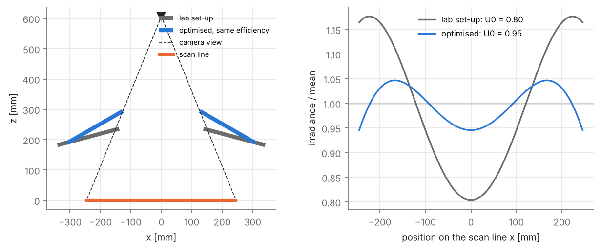
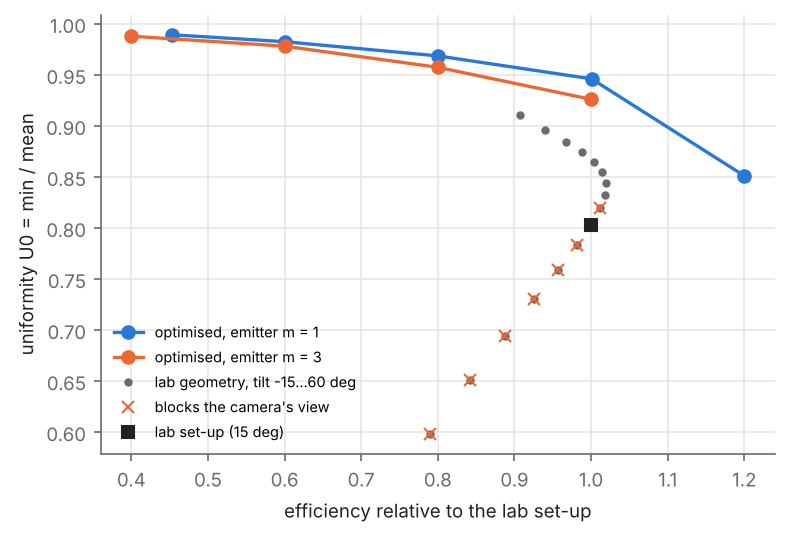

# linescan-lighting

Illumination design and geometric calibration for a **line-scan camera** inspecting a ~0.5 m scan line lit by two
rectangular light panels. Course project, *Simulation optischer Systeme* (M.Sc. Optimization, HSBI, winter term
2024/25), rebuilt as a package with scripts for every number and figure.

**Report:** [`report/report.pdf`](report/report.pdf)



## Results

| | |
|---|---|
| Objective | The absolute std of the irradiance is minimised by dimming the lights; uniformity must be relative (U0 = min/mean, CV). |
| Lab set-up | U0 = 0.80 over the 491 mm field of view; the panels seem to touch the camera's view cone (to be checked). |
| Optimised geometry | U0 = 0.95 at the same efficiency; 0.97–0.99 at 80–45 % efficiency; Pareto front uniformity vs efficiency. |
| Calibration | 8.34 px/mm (0.120 mm/px), repeatability 0.024 px, residuals 0.06 px after estimating the target's printing errors (up to ±0.14 mm). |
| Not validated | The illumination model: the available images are saturated (34–42 % of the pixels at 255). The report gives the measurement protocol. |



## Layout

```
src/lslight/
  illumination.py   point sources; tilted generalised-Lambertian panels (Gauss-Legendre); U0, CV
  design.py         view-blocking check, evaluation, differential-evolution optimisation of (W, z0, theta)
  linescan.py       sub-pixel edges, 1-D projective camera model, joint fit with target deviations
scripts/            point_source_study, design_study, calibrate_linescan, make_figures
data/images/        seven line-scan images of the checkerboard target (4096 px x 50 lines)
results/ figures/   outputs of the scripts
report/             LaTeX source, tables generator, PDF
tests/              tests on synthetic data
```

## Reproduce

```bash
pip install -r requirements.txt
python scripts/point_source_study.py
python scripts/design_study.py        # a few minutes (differential evolution)
python scripts/calibrate_linescan.py
python scripts/make_figures.py
pytest -q
cd report && python make_tables.py && make
```
